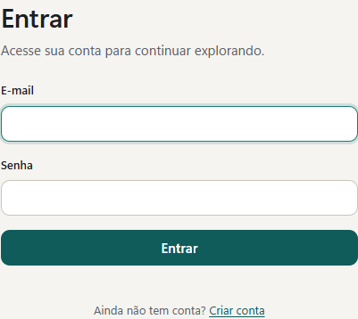
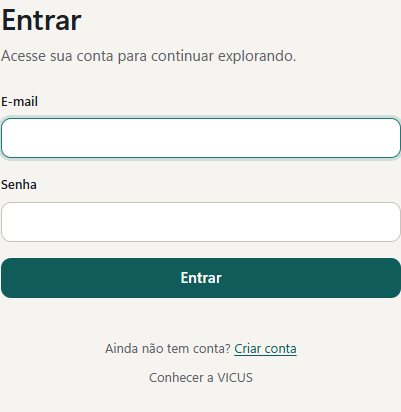

# Letras borradas: causa e correção

Medição de 2026-11-14, com o Microsoft Edge (playwright-core) a 1440×900 e com a escala do Windows simulada por `deviceScaleFactor`: 1 (100%), 1,25 (125%) e 1,5 (150%). Zoom do navegador em 100%.

Script: `perf/text-shots.mjs <prefixo> [landing] [app]`. Ele captura o capítulo 01 parado, o capítulo 04 no meio da sua faixa e o cartão de login do app.

## Causas encontradas

1. **A fonte Inter não carregava.** A landing pedia `font-family: Inter`, mas nenhum arquivo da fonte era servido. O Windows caía na Segoe UI, que fica mais fina e mais borrada nos tamanhos grandes e com `letter-spacing` negativo.
   - Correção: Inter variável local (`assets/fonts/inter-latin-wght.woff2`, subconjunto latino com português, 48 KB, licença OFL em `assets/fonts/LICENSE-Inter-OFL.txt`) com `font-display: swap` e `preload`.
2. **Texto em posição fracionária.** Os capítulos eram centralizados com `translateY(-50%)`. Numa caixa de altura ímpar, isso dá meio pixel, e o fade somava deslocamentos como `12.3px`. As etiquetas do mapa usavam `toFixed(1)`.
   - Correção: os capítulos são centralizados por `margin: auto` (sem transform). Durante o fade, o deslocamento é arredondado para pixel inteiro. Parado (opacidade 1), o capítulo fica com `transform: none`. As etiquetas do mapa também usam pixels inteiros.
3. **No app:**
   - O tooltip do mapa seguia a posição fracionária do mouse (agora arredondada).
   - O ícone da busca era centralizado com `translateY(-50%)` (agora com `margin: auto`).
   - O cartão de login já estava nítido, como mostram as capturas.

## O que verificamos e não era causa

- **`will-change: transform` nos capítulos:** a nitidez medida é a mesma com e sem ele (28,39 contra 28,40). Ele **continua** na landing porque, sem ele, o navegador criava e desfazia a camada de cada capítulo a cada troca. Isso causou quadros acima de 50 ms no desktop (ver PERFORMANCE.md).
- **`filter`/`backdrop-filter`:** só existem no fundo das etiquetas e dos critérios. O filtro borra o que está atrás, não o texto.
- **`letter-spacing` negativo** (−0,05 a −0,064 em): com a Inter carregada, os títulos ficam nítidos. Não mexemos no desenho.
- **`-webkit-font-smoothing: antialiased`:** só tem efeito no macOS. No Windows, o navegador o ignora.

## Antes e depois (100%)

| Trecho | Antes | Depois |
|---|---|---|
| Capítulo 01 da landing, 100% |  |  |
| Parágrafo do capítulo 01 a 125%, ampliado 3× sem suavização |  |  |
| Login do app, 100% |  |  |

## Nitidez medida

Média do gradiente de bordas (filtro `FIND_EDGES` do Pillow) no parágrafo: quanto maior, mais nítido.

| Trecho | Escala | Antes | Depois |
|---|---|---|---|
| Capítulo 01 | 100% / 125% / 150% | 25,9 / 24,5 / 22,9 | **28,4 / 27,5 / 25,7** |
| Login do app | 100% / 125% / 150% | 18,3 / 15,0 / 13,3 | **19,6 / 15,8 / 13,7** |

O capítulo 04 não entra na comparação numérica. Com a troca de Segoe UI para Inter, o mesmo recorte passa a conter outro texto (a quebra de linha muda), e a métrica deixa de comparar a mesma coisa. Visualmente, ele também ficou nítido.
